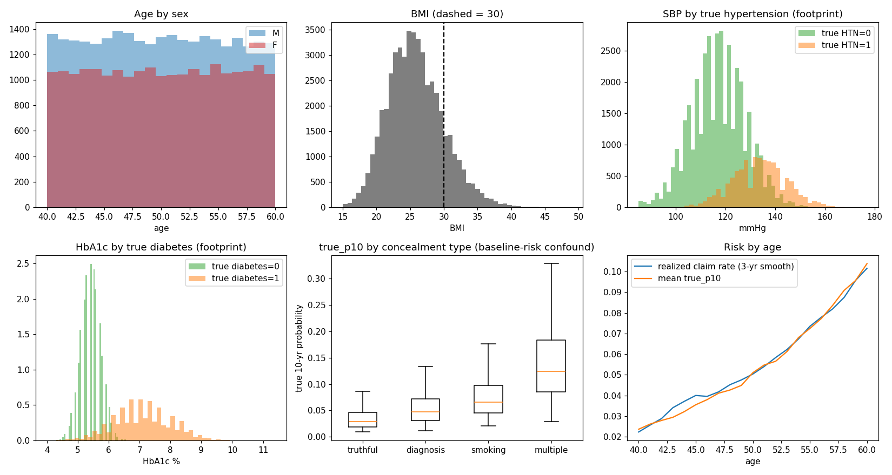
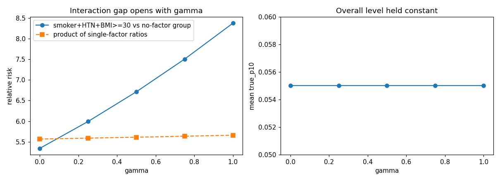

# Validation report (seed 2026, gamma 0.5; grid = 3 seeds x 5 gamma x 50,000)

## 0. Assertions

| Check | Result | Detail |
|---|---|---|
| No missing values in any column | PASS |  |
| applicant_id unique (one row per applicant => no pairing/leakage across splits) | PASS |  |
| train/val/test all present | PASS | {'train': 0.6, 'test': 0.3, 'val': 0.1} |
| declared_smoker never exceeds true_smoker (lies only hide, never invent) | PASS |  |
| declared_pack_years never exceeds true_pack_years (lies only hide, never invent) | PASS |  |
| declared_diabetes never exceeds true_diabetes (lies only hide, never invent) | PASS |  |
| declared_hypertension never exceeds true_hypertension (lies only hide, never invent) | PASS |  |
| declared_cvd never exceeds true_cvd (lies only hide, never invent) | PASS |  |
| truthful rows: declared == true on every concealable field | PASS |  |
| smoking concealers declare smoker=0 and pack_years=0 | PASS |  |
| true_p10 in (0,1) and mean equals target 5.5% (+-0.1pp) | PASS | mean=0.0550 |
| realized claim rate within 3 SE of mean p10_given_frailty | PASS | claim rate=0.0557, mean p given frailty=0.0548 |
| frailty Z has mean ~1 and variance ~0.25 | PASS | mean=1.000, var=0.250 |
| split identical at gamma=0 and gamma=1 (same people in same split) | PASS |  |
| concealment mix within 0.1pp of 65/15/12/8 | PASS |  |
| age~SBP, BMI~SBP, BMI~HbA1c, smoker~pack_years all positive | PASS |  |
| HTN and diabetes more common at BMI>=30 | PASS |  |
| claim rate rises with age | PASS |  |
| every test subgroup has >= 80 claims in every file | PASS | {'test_claims_truthful': 375, 'test_claims_smoking': 163, 'test_claims_diagnosis': 88, 'test_claims_multiple': 152} |
| gap widens monotonically with gamma | PASS |  |
| overall level held constant across gamma | PASS |  |

## 1. Concealment mix (target 65 / 15 / 12 / 8)
| concealment_type   |   share |
|:-------------------|--------:|
| truthful           |    0.65 |
| smoking            |    0.15 |
| diagnosis          |    0.12 |
| multiple           |    0.08 |

Share by split (stratified, should match):
| split   |   diagnosis |   multiple |   smoking |   truthful |
|:--------|------------:|-----------:|----------:|-----------:|
| test    |        0.12 |       0.08 |      0.15 |       0.65 |
| train   |        0.12 |       0.08 |      0.15 |       0.65 |
| val     |        0.12 |       0.08 |      0.15 |       0.65 |

Smoker share 34.9%; share of smokers who conceal smoking = 66% (design consequence of oversampling).
Honest smokers (matched control for smoking concealers): 5,972

## 2. Prevalence (design choices; NOT fitted to NHANES microdata)
|                 |   share |
|:----------------|--------:|
| smoker          |   0.349 |
| hypertension    |   0.218 |
| diabetes        |   0.075 |
| CVD             |   0.046 |
| BMI>=30         |   0.158 |
| heavy alcohol   |   0.105 |
| hazardous hobby |   0.052 |
| family history  |   0.2   |
| male            |   0.553 |

## 3. Relationships the generator was meant to produce (Pearson r)
|                     |     r |
|:--------------------|------:|
| age ~ SBP           | 0.327 |
| BMI ~ SBP           | 0.338 |
| BMI ~ HbA1c         | 0.254 |
| age ~ HbA1c         | 0.168 |
| smoker ~ pack_years | 0.855 |
| BMI ~ cholesterol   | 0.242 |

Condition rates by BMI (should rise with BMI):
|         |   HTN rate |   diabetes rate |
|:--------|-----------:|----------------:|
| BMI<30  |      0.2   |           0.061 |
| BMI>=30 |      0.313 |           0.152 |

Footprint (insurer-measured values by TRUE condition) - the settings locked in this phase:
|     |   SBP | HTN no / yes |   HbA1c | diabetes no / yes |   cholesterol | smoker no / yes |
|:----|---------------------:|----------------------------:|--------------------------------:|
| no  |               117.17 |                        5.41 |                          196.47 |
| yes |               133.49 |                        7.11 |                          202.78 |

## 4. Risk gradients (seed 2026, gamma 0.5)
| age_band   |     n |   claim_rate |   mean_true_p10 |
|:-----------|------:|-------------:|----------------:|
| 40-49      | 23890 |       0.0358 |          0.0341 |
| 50-60      | 26110 |       0.0739 |          0.0741 |
| sex   |   claim_rate |   mean_true_p10 |
|:------|-------------:|----------------:|
| F     |       0.0378 |          0.0356 |
| M     |       0.0702 |          0.0707 |

Baseline risk by concealment type - NOTE the confound that motivated amendment A9:
| concealment_type   |     n |   mean_true_p10 |   claim_rate |
|:-------------------|------:|----------------:|-------------:|
| diagnosis          |  6000 |          0.0593 |       0.0622 |
| multiple           |  4000 |          0.1443 |       0.144  |
| smoking            |  7500 |          0.0787 |       0.074  |
| truthful           | 32500 |          0.0377 |       0.0394 |

## 5. Power check - test-set claim counts per concealment subgroup (min / max over 15 files)
|                       |   min |   max |
|:----------------------|------:|------:|
| test_claims_truthful  |   375 |   408 |
| test_claims_smoking   |   163 |   214 |
| test_claims_diagnosis |    88 |   123 |
| test_claims_multiple  |   152 |   185 |
| test_claims           |   827 |   875 |

## 6. Does gamma open the interaction gap? (smoker + hypertension + BMI>=30, seed 2026)
|   gamma |   mean_true_p10 |   n_SHB |   SHB_vs_none |   product_of_singles |   excess_over_product |
|--------:|----------------:|--------:|--------------:|---------------------:|----------------------:|
|    0    |           0.055 |     991 |         5.341 |                5.568 |                 0.959 |
|    0.25 |           0.055 |     991 |         5.993 |                5.59  |                 1.072 |
|    0.5  |           0.055 |     991 |         6.713 |                5.612 |                 1.196 |
|    0.75 |           0.055 |     991 |         7.506 |                5.636 |                 1.332 |
|    1    |           0.055 |     991 |         8.376 |                5.66  |                 1.48  |

